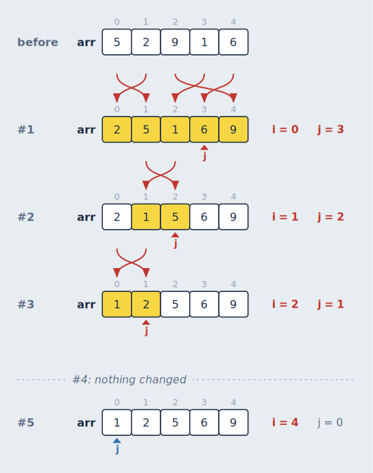
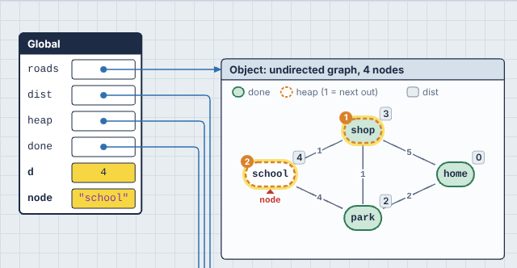

# PR0L1NE

[](https://github.com/D4YonSoundcloud/pr0-l1ne/actions/workflows/ci.yml)

**See your code run.** Write Python, JavaScript or TypeScript, and PR0L1NE draws every variable, list, object and scope as it changes, step by step, right in your browser. Or write SQL, and watch a query work through its table one clause at a time.

**[Try it: pr0l1ne.com](https://pr0l1ne.com)**. Nothing to install and no account; your code never leaves your browser.



## What it does

- **Memory view.** Variables, lists, dicts, objects and call frames drawn as boxes and arrows, updated on every step. Trees are drawn top-down, linked lists left to right.
- **Loop history.** Each pass of a loop stacked under the last, with red arrows showing exactly what changed, or animated in place as you press Play.
- **Graphs.** Adjacency lists, matrices and tries drawn as nodes and edges, with your algorithm's own state on them: the visited set, the queue, distances, the path.
- **Big inputs.** Long loops are sampled and long lists drawn as color strips, so large programs still trace.
- **Measure and complexity.** An estimate of time and space complexity from the code, checked against real runs at several input sizes.
- **SQL, clause by clause.** Queries run on a real PostgreSQL in your browser, drawn in the order Postgres runs them (FROM, WHERE, SELECT, ORDER BY, LIMIT): the table at each clause, every row kept or dropped and why. Sample databases to start from, or make your own tables. See [SQL](docs/sql.md).
- **Hints.** `# viz:` and `// viz:` comments tell the canvas how to draw things when its automatic choices aren't what you want.
- **Share links.** **Share** copies a link with your program inside it: whoever opens it sees the code, ready to run in their browser's sandbox. Nothing is stored on a server.
- **Works on a phone.** Pick which one or two of the code, memory view and loop history to see.
- **SVG or Canvas 2D.** The diagrams are SVG by default, or drawn with [PixiJS](https://pixijs.com) on a canvas, which pans and zooms smoothly around big drawings (Style → Rendering). **Save SVG** saves either as a vector file.



Python runs in a real CPython interpreter compiled to WebAssembly ([Pyodide](https://pyodide.org)), downloaded the first time you pick Python. JavaScript runs in the browser's own engine; TypeScript has its types removed and runs the same way. SQL runs on PostgreSQL compiled to WebAssembly ([PGlite](https://pglite.dev)), downloaded the first time you pick SQL.

## Run it locally

You need [Node.js](https://nodejs.org) 22 or newer.

```bash
git clone https://github.com/D4YonSoundcloud/pr0-l1ne.git
cd pr0-l1ne
npm ci
npm run dev
```

Then open the address it prints (usually http://localhost:5173). `npm test` runs all the tests; `npm run build` makes the static site in `dist/`.

## Documentation

Read it on the site, with search: **[pr0l1ne.com/docs](https://pr0l1ne.com/docs/)**. The same pages are in [`docs/`](docs/).

| | |
| --- | --- |
| [User guide](docs/user-guide.md) | Every feature in detail |
| [SQL](docs/sql.md) | Queries stepped through clause by clause, and the sample databases |
| [Hints: `viz:` comments](docs/hints.md) | Steering how things are drawn |
| [How it works](docs/how-it-works.md) | Tracers, the trace format, drawing and measuring |
| [Development](docs/development.md) | Commands, deploying, project structure, extending it |
| [Limitations and troubleshooting](docs/limitations.md) | What it can't do yet, and common fixes |
| [Roadmap ideas](docs/roadmap.md) | What might come next |

## Contributing

Bug reports and ideas are welcome in [Issues](https://github.com/D4YonSoundcloud/pr0-l1ne/issues). If a drawing looks wrong, include the program and the step number. For code changes, start with [Development](docs/development.md).

## License

[AGPL-3.0-or-later](LICENSE). You can use, study, change and share PR0L1NE freely. If you run a changed version as a public website, you must share your changes under the same license.
