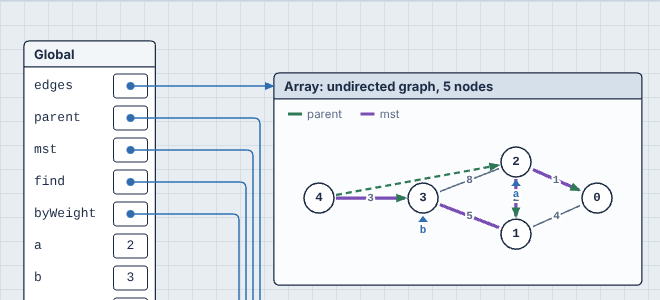

[← Docs index](README.md)

# Hints: `viz:` comments

PR0L1NE chooses what to draw automatically, but sometimes its guesses aren't what you want: a helper variable clutters the loop history, `cur` isn't recognized as a position in a list, a tree with parent pointers comes out as a list, or a list of lists is really a graph. A **hint** is a comment that tells it what you meant.

The quickest way to learn them is the **Hints, step by step** group in the Open… menu: [ten examples](#learning-hints-with-the-examples), from one hint to all of them together.

```python
# viz: hide temp
# viz: pointers nums: first, last
def rotate(nums):
    first, last = 0, len(nums) - 1
    while first < last:
        temp = nums[first]
        nums[first] = nums[last]
        nums[last] = temp
        first += 1
        last -= 1
```

A hint is a comment whose text starts with `viz:`:

| Language | Hint comments |
| --- | --- |
| Python | `# viz: ...` |
| JavaScript and TypeScript | `// viz: ...` or `/* viz: ... */` |

- **It can go anywhere**: on a line of its own, at the end of a line of code, at the top of the file. Hints apply to the **whole program**, not just the code near them, so a common style is to put them at the top. A hint in a string (`"# viz: hide x"`) isn't a comment, so it's ignored.
- **One hint per comment.** Write several comments for several hints.
- **Keywords aren't case sensitive**, and spacing is flexible: `# VIZ:  Hide a ,b` works.

## The hints

| Hint | What it does |
| --- | --- |
| `viz: hide temp, scratch` | Never draws these variables, in any frame, in the memory view or the loop history. Objects only they point at disappear too. Useful for helper variables, or `self`/`this` when it's noise. |
| `viz: show total, seen` | Always includes these variables in the loop history, even when PR0L1NE would leave them out because they don't change during the loop. |
| `viz: pointers nums: lo, hi` | Draws `lo` and `hi` as [pointer markers](how-it-works.md#pointer-detection) under `nums` whenever they hold a whole number, for names the code never writes as `nums[lo]`. |
| `viz: pointers grid[]: col` | The same, for a **grid**'s columns: `col` is marked under a column of `grid`. (Use `pointers grid: row` for its rows.) |
| `viz: tree Node(left, right)` | Draws objects of class `Node` as a binary tree, using `left` and `right` as the children, in both the memory view and the loop history. Other fields, like `parent`, are drawn as plain fields. |
| `viz: list Node(next)` | Draws objects of class `Node` as a linked list in the loop history, using `next` as the link. Other fields, like `prev` or `random`, aren't drawn as links. |
| `viz: graph adj` | Draws `adj` as a [graph](user-guide.md#graphs): a dict, a list of neighbor lists, an adjacency matrix or an edge list. `self.adj` or `this.adj` work too, or just the field name. |
| `viz: graph adj: seen, todo, here` | The same, and also draws these variables on the graph, whatever they're called. Each is drawn by its type: a set fills nodes in, a list numbers them, a dict of numbers labels them, a variable holding a node gets a ▲ marker. |
| `viz: graph Node(neighbors)` | Draws objects of class `Node` as a graph, with `neighbors` as the edges. It can be a list, a set, a dict (its keys label the edges) or a direct link. List several fields to use them all. |
| `viz: plain graph` | Never draws `graph` as a graph, even though it looks like one. It's drawn as an ordinary dict or list instead. Takes variable or class names. |
| `viz: size n` | Marks `n` as the input size, for [growth runs](user-guide.md#how-it-grows). `n` must be set to a number at the top level of the program (`n = 40000`). `viz: size n = 40000, k` names several, with an optional full size to grow to. |

Names are the variable or field names as written in your code. Class names in `tree`, `list` and `graph` are what the canvas shows as the box title (a Python class name, or a JavaScript constructor name). If two hints name the same class or variable, the later one wins.

### Graph options

Words between a graph hint's target and its colon change how the graph is read or drawn. Any number of them can be combined:

| Option | Effect |
| --- | --- |
| `directed`, `undirected` | Draw arrowheads, or don't. Without either, a graph is undirected when every edge goes both ways. |
| `matrix` | Read a list of lists as an adjacency matrix: `m[i][j]` is the edge from `i` to `j`. `0`, `False`, `None`, `-1` and infinity mean no edge. Other numbers are weights, and are shown unless every edge is `1` or `True`. |
| `edgelist` | Read a list of `(a, b)` or `(a, b, weight)` as edges. Python tuples are read this way without the option. |
| `layered`, `force`, `circle` | Lay it out in layers from top to bottom, spread out by distance (`force`: nodes a few edges apart sit about that far apart), or in a ring. Without one, it's layered when that reads well (trees, and directed graphs with no or few cycles), a circle for a ring (or a small dense graph, when that crosses fewer edges), and spread out by distance otherwise. `layered` works for any graph: edges that close a cycle point up. |

```python
# viz: graph flights matrix directed circle: reach, city
```

## When a hint is wrong

A hint that PR0L1NE can't understand doesn't stop your program. It's ignored, and you're told why in two places: a yellow banner at the top of the canvas (`Hint on line 3: Unknown hint "colour blue". Hints are: hide, show, pointers, tree, list, graph, plain.`) and a yellow squiggle under the comment in the editor, which you can hover. Each message shows the form the hint should take, such as `viz: tree Node(left, right)`.

A hint that's well-formed but names something that doesn't exist (`hide nmus`) does nothing, since it may refer to a variable that only exists in some runs.

## Learning hints with the examples

The **Hints, step by step** group has the same ten examples in every language. Each starts with its hints and a comment explaining what they change. Deleting a hint line and watching the canvas change is a good way to see what it does.

| Example | Hints | What it shows |
| --- | --- | --- |
| 1 · hide | `hide before, receipt` | A running total, without the helper variables cluttering the loop history |
| 2 · show | `show target` | A linear search that keeps the value it's looking for in every row, though it never changes |
| 3 · pointers | `pointers nums: read` | Removing duplicates in place: `read` comes from `enumerate()`, so only the hint can mark it |
| 4 · grid pointers | `pointers grid: r`, `pointers grid[]: c` | Column sums: marking a grid's row and column when the code walks rows with `for row in grid` |
| 5 · tree | `tree Node(left, right)` | A binary search tree with parent links, drawn top-down instead of as a list |
| 6 · list | `list Item(next)` | A list whose items also have `random` links, followed along `next` only |
| 7 · graph | `graph adj` | A depth-first search over neighbor lists by number, with `seen`, `stack`, `u` and `v` drawn on it |
| 8 · graph options | `graph flights matrix directed circle: reach, frontier, city, nxt` | An adjacency matrix, read as a directed graph and drawn in a ring |
| 9 · edge list | `graph edges edgelist undirected: parent, mst, a, b` | Kruskal's algorithm: the union-find forest in green and the chosen edges in purple |
| 10 · all together | `graph`, `plain`, `hide` and `show` | Dijkstra on a road map with a closed road: costs, the frontier, the tree of best routes and the final route all on the graph |


