[← Docs index](README.md)

# User guide

## Overview

PR0L1NE is a split-screen tool for seeing your code's data while you write it. Python, JavaScript or TypeScript goes in the editor (or SQL: see [SQL](sql.md), which has a page of its own). Next to it, a graph-paper canvas draws every variable, list, dict, object, function and scope as SVG. When your code is inside a loop, the loop history animates its current pass in place, so you can press **Play** to watch values slide into place step by step. Or switch to stacked mode, and each iteration is stacked under the last one with red arrows showing exactly what changed.

Binary trees are drawn top-down. Graphs (adjacency lists, matrices, tries, graphs of objects) are drawn as nodes and edges, with your algorithm's own state on them: the visited set filled in, the queue numbered, distances labeled, the search tree in green. Generators and `async` functions get their own frames that pause and resume, and `# viz:` / `// viz:` comments let you tell the canvas how to draw things when its automatic choices aren't what you want.

Big inputs still trace: long loops are **sampled** (their first passes, passes at round numbers and their last passes are recorded, and the rest are counted), and a long list of numbers is drawn as a **color strip** of all of it, with the cells following your index variables. For the full picture, **Measure** runs the whole program at full size with counters instead of a trace: how many times every line ran, the work hidden inside built-ins, time and memory. Mark the input size with a hint (`# viz: size n`) and Measure reruns the program at n/64, n/16, n/4 and n to chart **how it grows**, against the code's estimate and against other versions you kept.

It also estimates your code's **time and space complexity** (O(n²), O(n log n), O(V + E)) from the shape of the code, checks the estimate against the run, and labels every loop and function in the editor with what it costs.

It's free, there's no sign-up, and it runs entirely in your own browser, so there's no server to set up and your code never leaves your computer. Python executes in a real CPython interpreter compiled to WebAssembly ([Pyodide](https://pyodide.org)). JavaScript runs in the browser's own engine, after PR0L1NE rewrites it to report on itself as it runs. TypeScript has its types removed and then runs the same way.

## Choosing a language

The menu at the left of the toolbar switches between **Python**, **JavaScript**, **TypeScript** and **SQL**. Each language keeps its own code, undo history, saved programs and examples, so switching back and forth doesn't lose anything. A first visit opens in JavaScript, and after that the page remembers the language you used last. Python's runtime (about 6 MB) is only downloaded the first time you pick Python: while it loads, a card over the canvas shows a spinner and a moving bar with what's downloading and how big it is, and the status in the toolbar reads "Downloading Python (6 MB)…" beside a small spinner. Your browser keeps a copy after that. SQL's database (PostgreSQL, about 8 MB) is downloaded the same way, the first time you pick SQL.

Each language has its own address: [pr0l1ne.com/javascript](https://pr0l1ne.com/javascript), [/python](https://pr0l1ne.com/python), [/typescript](https://pr0l1ne.com/typescript) and [/sql](https://pr0l1ne.com/sql). The address changes as you switch language, so you can bookmark or link to a language, and the browser's Back button goes back to the language before. [pr0l1ne.com](https://pr0l1ne.com) itself opens the language you used last (JavaScript the first time) and shows its address. Share links keep working at any of them.

SQL is drawn differently from the other three: a query is stepped through one clause at a time, with the table at each step, instead of variables and loops. [SQL](sql.md) has the details. Everything below is about Python, JavaScript and TypeScript, except where it says otherwise.

The visuals are the same for every language, but JavaScript's semantics show through in a few places (all of these apply to TypeScript too):

- **Block scoping is visible.** A `let` or `const` declared inside a loop or block only appears while that block is running. In the bubble sort, the inner loop's `j` shows up in the inner loop's history but not in the outer loop's, because it doesn't exist there.
- **Variables appear when they're declared.** A `let` or `const` isn't shown until its declaration has run, since reading it earlier is an error in JavaScript. A `var` appears from the start of its function as `undefined`, because that's how hoisting works.
- **Plain objects are drawn as dictionaries.** `{}` is JavaScript's everyday map, so `counts[word]++` gets the same growing-dictionary loop view as a Python dict, with keys shown unquoted. A `Map` is drawn the same way. Instances of your own classes are drawn as objects with fields.

  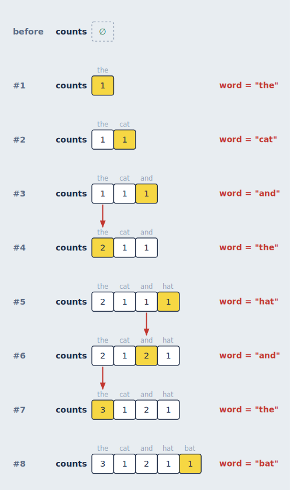
- **Methods show `this`.** Inside a class method or object method, `this` appears as a variable on every step, the way Python shows `self`. Arrow functions inside a method show it too, since they share the method's `this`.
- **Function names come from where they're defined.** `const double = (x) => x * 2` appears as `double()` on the call stack, and class methods appear as `ClassName.method()`.

## TypeScript

TypeScript is traced as the JavaScript it compiles to, so everything in the previous section applies, and types themselves never appear on the canvas. That's not a shortcut: types don't exist while a program runs, so there's nothing to draw. A few things are worth knowing:

- **Types aren't checked.** PR0L1NE removes types without checking them, the way esbuild, Vite and `tsc --noCheck` do. Code with type errors still runs, and you'll see what it actually does. Syntax errors are still reported.
- **Your line numbers are exact.** Removing an `interface` or `type` doesn't shift anything, so the highlighted line is always the one you wrote.
- **Enums are real objects.** An `enum` compiles to an object, so it appears in the heap. Numeric enums map both ways (`Light.Red` is `0` and `Light[0]` is `"Red"`), which you'll see as both kinds of key.
- **Parameter properties work as expected.** `constructor(public val: T, public next: ListNode<T> | null = null) {}` sets the fields without producing extra steps for the generated `this.val = val`.
- **Compiler-generated code is hidden.** The helper functions behind enums and namespaces run without being traced, so they don't clutter the call stack. That also means code *inside* a `namespace` block runs untraced, though its exports work normally.

## Saving programs

Press **Save** or `Ctrl/Cmd + S` to keep the program you're working on. The first time, you're asked for a name. After that, `Ctrl/Cmd + S` saves over it, the way it does in VS Code. `Ctrl/Cmd + Shift + S` always asks for a name, so you can save a copy under a new one.

The program's name sits in the toolbar next to the **Open…** menu. A yellow dot after it means there are unsaved changes, and the dot disappears when you save. A program that hasn't been saved yet is shown as *Untitled*.

**Open…** lists your saved programs for the current language, most recently saved first, followed by the examples. If the program you're leaving has unsaved changes, you're asked before they're discarded. **Delete** appears while a saved program is open. Deleting it keeps the code in the editor as an untitled program, so nothing disappears from the screen until you open something else.

Saved programs are stored in your browser (in `localStorage`), separately for each language. They survive reloads and restarts, but they belong to this browser on this machine, and clearing the site's data removes them. Separately from saving, PR0L1NE always keeps whatever is in the editor, saved or not, so a reload never loses work in progress.

## Sharing a program

**Share** in the toolbar copies a link to the code in the editor. Whoever opens it sees that program, in its language, ready to run. The program travels inside the link itself (the part after `#`), so it's never sent to or stored on any server: the link works as long as PR0L1NE does, and anyone who has it can open the code.

Opening a link shows the program as a **Shared program** with a note that it's someone else's code. Nothing runs until you press **Run it** (or Run), so you can read it first, and when it runs, it runs in the [sandbox](how-it-works.md#security-running-other-peoples-code) like any program. **Save to my programs** keeps it. Your own work is left alone: your saved programs, and the unsaved code you had in that language, are as they were until you edit the shared program. Once you do, it's your unsaved code, as if you'd typed it, and the link leaves the address bar.

Programs up to about 30 KB once packed fit in a link (every example takes under 1.5 KB). A link can't be changed or deleted after it's shared: change the code and share again for a new link. If the browser can't copy to the clipboard, the link is shown in the banner to copy by hand.

## Examples

The **Open…** menu has 37 to 39 examples per language, grouped by topic (SQL has its own: see [SQL examples](sql.md#examples)). Each one is short enough to step through, and each shows off a different part of the canvas:

| Group | Examples |
| --- | --- |
| Sorting | Bubble sort, insertion sort, merge sort (recursion; generic in TypeScript) |
| Searching and two pointers | Binary search, reversing a string with two pointers, two sum with a hash map, a sliding window, word frequency |
| Linked lists and trees | Reversing a linked list, finding a cycle with fast and slow pointers, binary search tree insert, in-order traversal, a trie |
| Graphs | Breadth-first search with the shortest path, recursive depth-first search, Dijkstra's algorithm, topological sort, a graph of objects |
| Grids and dynamic programming | Grid paths, longest common subsequence, coin change, flood fill (number of islands), Fibonacci with a memo (Python and JavaScript) |
| Functions, classes and generators / async | Recursion, closures, a class with methods, generators; async tasks (`asyncio` in Python; with timers in JavaScript and TypeScript); array callbacks in JavaScript and TypeScript; a generic class and an enum in TypeScript |
| Hints, step by step | Ten examples that teach [hints](hints.md#hints-viz-comments), from a single `hide` to every kind of hint at once |

The same topics exist in every language, written the way that language would write them: a `deque` and `heapq` in Python, a `Map` and `Set` in JavaScript, typed `Record`s and generics in TypeScript.

## The editor

The editor on the left is [Monaco](https://microsoft.github.io/monaco-editor/), the editor component VS Code is built on, so VS Code's editing and navigation keys work as you'd expect: multi-cursor (`Ctrl/Cmd + D`, `Alt + Click`), move and copy lines (`Alt + ↑/↓`, `Shift + Alt + ↑/↓`), toggle comments (`Ctrl/Cmd + /`), go to line (`Ctrl + G`), find and replace, bracket jumping, folding, and the command palette (`F1`).

With **Live** checked, the program re-runs 600 ms after you stop typing. Otherwise, press **Run** or `Ctrl + '`. Your code is saved in the browser, so it survives a reload. The **Open…** menu has your [saved programs](#saving-programs) and starter examples that each exercise a different part of the canvas. Opening a program or an example is a normal edit, so `Ctrl/Cmd + Z` brings the previous code back.

PR0L1NE adds a few commands of its own, borrowing VS Code's debugger keys for stepping:

| Keys | Command |
| --- | --- |
| `Ctrl + '` | Run. Works anywhere on the page, not just in the editor, and is `Ctrl` on a Mac too |
| `Ctrl/Cmd + Enter` | Play from the current step. Pressed again while playing, it stops and goes back to the step it started from. Works anywhere on the page |
| `Ctrl/Cmd + S` | Save (asks for a name the first time) |
| `Ctrl/Cmd + Shift + S` | Save as a new program |
| `F10` | Next step |
| `Shift + F10` | Previous step |
| `F1`, then type "AlgoViz" | All of PR0L1NE's commands (their palette names still start with "AlgoViz:"), including first and last step, play/pause, and swapping the panels |

Hint comments that PR0L1NE can't understand get a yellow warning squiggle; hover it to see what was expected (see [Hints](hints.md#hints-viz-comments)).

While you step through a run, the editor marks lines with a tint and a bar in the gutter (and a matching mark in the scrollbar):

- **Yellow**: the line that just ran. This is the line whose effects the canvas is showing.
- **Blue**: the line that runs next.

If the same line ran and runs next (a loop around a single statement), it's yellow. The editor scrolls to keep the yellow line in view while you step, unless you're typing.
- **Red**: where an error happened (shown once you reach the last step). The error is also a real diagnostic with a squiggle, so hovering shows the message and `F8` jumps to it.

If you're mid-edit and the code has a syntax error, the canvas keeps showing the last version that ran (dimmed), a banner explains what's wrong, and the line is marked in the editor.

## Layout

On a wide screen, the code, the memory view and the loop history can go anywhere on the page. To begin with, the code is on the left and the memory view sits over the loop history on the right.

**Moving a window.** Drag a window by the grip (⠿) at the left of its header, or by its name. A box shows where the window will go and glides there as you move:

- **Near another window's side**, it goes beside that window on that side. Drop the memory view on the left of the code to put it there, or under the code to stack the two.
- **In the middle of another window**, the two swap places, keeping their sizes.
- **Near an edge of the page**, it goes along that whole edge: the code across the bottom, say, with memory and loop history side by side above it.

Let go to move it; the windows glide to their new places. Press `Esc`, or drop it back on itself, to leave everything where it was. Any arrangement of the three works: the code in the middle with memory and loop history either side, all three in a column, one window across the top with the other two below it, and so on. From the keyboard, focus a window's grip with `Tab` and press an arrow key to move the window to that edge of the page.

Two buttons in the toolbar set the usual arrangements. The **layout button** switches between **stacked** (the code beside memory over loop history) and **side by side** (all three in columns, for SQL: the code, Tables, Query steps), which suits a wide monitor. **⇄** moves the code to the other side of the page, the other windows keeping their order. It's also in the command palette as "AlgoViz: Swap Editor and Canvas". Wherever the windows are, it's remembered.

Drag a divider between windows to resize them, or focus it with `Tab` and use the arrow keys. Double-click it to go back to the usual size. Sizes are remembered too.

### Maximizing and minimizing windows

Each window (the code, memory and loop history) has two buttons at the right end of its header:

- **Minimize** (–) folds the window to a thin bar with its name, and the other two windows take its room.
- **Maximize** (□) folds the other two windows to bars, so this one gets the whole workspace. Press it again (it shows two overlapping squares while the window is maximized) to bring all three back.

Click a bar to open its window again. One window always stays open: minimizing the only one still open brings the other two back instead. The Style, Layout, Complexity and Measure panels still open while the code window is folded. Which windows are folded is remembered.

### On a phone

A phone screen can't fit the editor, the memory view and the loop history at once, so a bar under the toolbar picks which show: **Code**, **Memory** and **Loops**. Up to two show at a time, one above the other (side by side when the phone is on its side):

- Tap a window that's hidden to show it. If two were already showing, the one you picked longest ago makes room.
- Tap one of two that are showing to hide it, and the other fills the screen.

It starts with the code and the memory view, and remembers what you pick. On a phone the toolbar's buttons are one row that scrolls sideways, with **Run** first; the window headers scroll sideways the same way. The Style, Layout, Complexity and Measure panels open over the whole screen, so they work whichever windows are showing. Both windows start with [Auto-fit](#auto-fit) on, so the whole diagram fits.

The layout button and the window buttons aren't shown on a phone, which has this layout instead. This layout is used on any screen narrower than 820 pixels, or shorter than 500 (a phone on its side); a tablet held upright gets it too.

## Styling the canvas

**Style** in the toolbar opens a panel for how the canvas looks. Every change shows up on the canvas as you make it, and is remembered in this browser. The panel floats over the editor, whichever side the editor is on, so the canvas stays fully in view and keeps working while it's open. Close it with **×**, `Esc`, or the **Style** button.

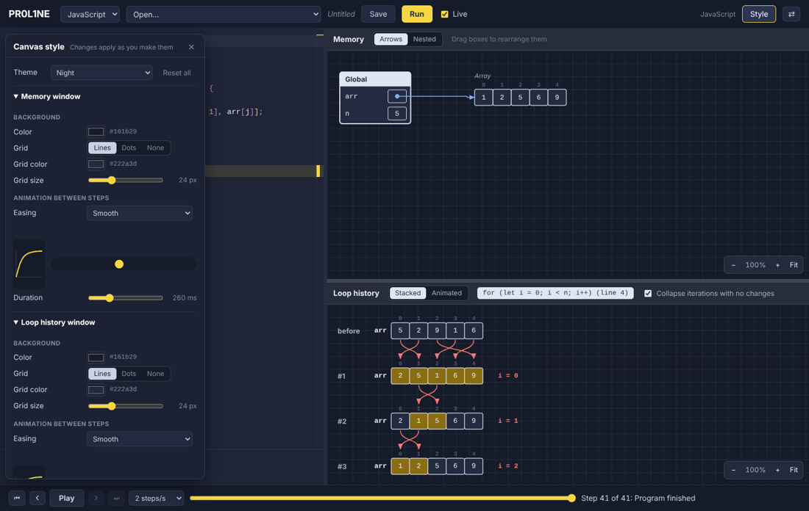

| Section | What you can change |
| --- | --- |
| **Rendering** | Whether the windows are drawn with **SVG** (the default) or **Canvas 2D**. See [SVG or Canvas 2D](#svg-or-canvas-2d) below. |
| **Theme** | A starting point: **Graph paper** (the default), **Whiteboard** (white, no grid), **Dot grid**, **Blueprint** (white lines on blue), **Night** (dark) and **High contrast**. Changing anything after that makes it **Custom**. **Reset all** goes back to Graph paper. |
| **Memory window** and **Loop history window**, separately | The **background color**. The **grid**: lines, dots or none, its **color** and its **size** (it still scales with zoom). The **easing** of the animation between steps: Smooth, Linear, Ease in and out, Ease out, Ease in, Overshoot, Snap, or any `cubic-bezier(...)` you type. Its **duration**, from 0 (no animation) to 1000 ms. And how new things arrive: **Fade in** (on by default) and **Slide in** (from the left, with the window's easing; off by default), together, one or the other, or neither so they just appear. **Same as the memory window** copies all of it to the loop history. |
| **Colors** | Every color in the diagrams: lines and text, cell and box fills, box titles, function and class titles, numbers, strings and constants, the yellow "changed" highlighter, the red change arrows, the blue references and pointers, sliding windows, memory sizes, the printed-output card and its text, the graph colors (visited, waiting, search tree, path), and the text drawn straight on the background (names, labels, index numbers). |
| **Printed output** | How the [printed-output card](#printed-output) arrives: **Fade in** and **Slide in** (turn both off and it just appears), **Fade the dimming** (with Dim others on, the rest fades down and back up rather than switching at once), and the **duration**, 0 to 1000 ms. |
| **Lines and text** | **Arrow thickness** (0.5× to 3×), **box outlines**, **cell corners** (square to round), the **code font** used in the diagrams, whether changed cells **flash** when they turn yellow, and **Show arrows through boxes** (x-ray: a faint dashed line where an arrow passes behind a box). |

**Previewing animation.** Next to the easing menu, a curve shows its shape. Click the track beside it and a dot slides across once, with your easing and duration (it stays still until you click). **▶ Replay this step** at the bottom redraws the previous step and animates into the current one, so you can watch the real thing. Bubble sort is a good example to try it on, since its swaps slide.

The window headers (the strips with "Memory" and the Arrows | Nested switch) take their colors from each window's background, so a dark theme is dark all the way up.

### SVG or Canvas 2D

The **Rendering** section at the top of the Style panel picks how the two windows are drawn. Both draw exactly the same picture, from the same layout, in the same colors, with the same animations, dragging, hover highlights, Auto-fit and zooming. What differs is how the picture reaches the screen.

| | SVG (the default) | Canvas 2D |
| --- | --- | --- |
| **How** | Every box, arrow and value is an element of the page | Drawn with [PixiJS](https://pixijs.com) on one canvas the size of the window, only what's in view |
| **Stepping** | Quicker: each step changes only the elements that changed | A little slower: the canvas is painted whole each step |
| **Panning and zooming big drawings** | Can stutter: the browser redraws thousands of elements as you zoom | Smooth, however big the drawing gets |
| **Zoomed in** | Always sharp | Lines are always sharp; text is redrawn sharp a moment after you stop zooming |
| **Screen readers** | Can read the values in the diagram | Can't read the diagram itself, only the window names |
| **Save SVG** | Yes | Yes, the same file |

Pick **SVG** for most programs, or if you use a screen reader. Pick **Canvas 2D** if you're exploring a big drawing (hundreds of boxes, a long loop history) and panning or zooming around it stutters. Your choice is remembered. The canvas renderer downloads the first time you pick it (about 100 KB). If it can't start in your browser, the Style panel says so and the windows stay on SVG.

A few small differences on the canvas: a box doesn't get a soft shadow while you hover over it, and a box being dimmed (by [Dim others](#printed-output)) fades each of its parts rather than the box as a whole, which can show a hint of the box's outline through its cells.

## Spacing the diagrams

**Layout** in the toolbar, next to **Style**, opens a panel for how the memory view and the loop history are spaced: how far apart columns, boxes, rows and arrows are. Like the Style panel, it floats over the editor so the canvas stays in view, and the step on screen is redrawn as you drag each slider, so you see the effect at once. Close it with **×**, `Esc` or the **Layout** button.

Each setting has a slider, a box where you can type the exact number of pixels, and **↺** to put it back to its default (shown once it's changed, with a yellow dot by its name). The settings come in three sections, each with its own **Reset section** button:

| Section | Settings |
| --- | --- |
| **Memory view: arrows** | **Lane spacing** (between arrows running side by side), **Lane inset** (from a box's edge to the first lane), **Forward distance** (how far right a target must be for an arrow to go straight to it), **Clearance** (between boxes and an arrow going over or under them), **Arrowhead spacing**, **Tree turn-in** (how far above a tree node an arrow turns in), and **Go around** (how much longer an arrow will be to go around a box instead of [behind it](#following-the-arrows); 0 sends them behind whenever that's shorter) |
| **Memory view: boxes** | **Column gap**, **Busy column gap** and **Busy after** (a gap with more arrows than that gets the busy width), **Box spacing** (one above another), **Margin**, **Room above** (for arrows that go over the top), **List arrow drop** and **List arrow lanes** (arrows leaving a list's cells), and the spacing of a binary tree's nodes and levels |
| **Loop history** | **Row spacing**, **Container spacing**, **Variables gap** (before `i = 2  j = 0`), **Stacked spacing** (with One per line), **Nested indent**, the room a linked list leaves for its arrows (**Linked node spacing**, **Room for arcs above** and **below**), **Tree level spacing**, and **Margin** |

Each slider stops where the layout stops working, so no setting can make boxes overlap or send arrows through boxes. Where two settings depend on each other, the layout makes room on its own: a gap is never narrower than its arrows need, however small you set it.

**Saving layouts.** The spacing you set is remembered in this browser. To keep more than one, type a name in **Save as** and press **Save** (or `Enter`): the **Layout** menu then lists it, and picking it, or **Default**, switches the drawing over at once. Saving under a name that's already taken replaces that layout. **Delete** removes the layout selected in the menu, leaving the spacing on screen as it is. Once you change anything, the menu says **Custom (not saved)** until you save it. **Reset all** goes back to the default spacing.

Boxes you've [dragged](#rearranging-the-memory-view) stay where you put them; **Reset layout** in the memory window puts them back in their automatic places, with the new spacing.

## Saving a picture

**Save SVG**, in each window's toolbar next to Auto-fit, saves what the window is showing as an SVG file: a vector picture that stays sharp at any size. It works with either renderer, and opens in a browser or a drawing app (Inkscape, Figma, Illustrator...) where you can edit it further. The file is named after the program, the window and the step (`bubble-sort-memory-step-12.svg`).

The file carries its own colors, line widths and fonts, so it looks the same outside PR0L1NE, with the window's background color behind it and no grid. Text uses the diagram font from the Style panel; if the computer that opens the file doesn't have that font, it falls back to another monospace font.

## Moving around the canvas

Each canvas section is its own sheet of graph paper that you can move around independently:

| To | Do this |
| --- | --- |
| Pan | Drag an empty part of the paper, or scroll (two fingers on a trackpad, `Shift` + scroll to go sideways) |
| Zoom | `Ctrl/Cmd` + scroll, pinch on a trackpad or touch screen, or the **−** / **+** buttons |
| Reset the view | Click the zoom percentage, or press `0` with the section focused |
| See everything | **Fit** shrinks the diagram until it all fits (it never enlarges) |
| Keep everything in view | **Auto-fit** refits on every step (see below) |

With a section focused (click it or `Tab` to it), `+` and `−` zoom too. The arrow keys still step through the program.

The zoom controls float at the bottom right of each section. If they cover something, **›** at their right end folds them into a small **‹ Zoom** button (click it to open them again). Each section remembers whether its controls are folded.

Each section's header is always one row: when its buttons don't fit (a narrow window, or side by side), the row scrolls sideways, with a fade at the side that has more. Scroll it with a mouse wheel or a trackpad. The header never changes height, so the drawing under it never jumps or rezooms.

Zooming centers on the pointer, so you can zoom into the part you're looking at. Each section keeps its own position and zoom as you step and as your code re-runs. While you step through a loop, the loop history pans just enough to keep the running iteration in view.

### Auto-fit

**Auto-fit**, next to the zoom buttons, keeps the whole diagram in view on every step. When a step needs a different zoom (a new object appears, a tree grows a level, the loop history gains a row), the canvas glides there with the same easing and duration as that window's step animation in the [Style panel](#styling-the-canvas). The memory view and the loop history each have their own Auto-fit. It's on to begin with, and turning it off (or changing its mode) is remembered.

The **▾** next to it picks how it zooms:

- **Zoom in and out** (the default) always fits snugly. It zooms back in when the diagram gets smaller.
- **Zoom out only** keeps the widest view the run has needed. Stepping back to a small early step, or a diagram that shrinks, doesn't zoom back in, so the picture stays steady while you step back and forth.

Like **Fit**, it never zooms in past 100%. Zooming or panning by hand turns Auto-fit off, so it never fights you, and pressing **Auto-fit** turns it back on with a fresh, snug fit. Opening another program also starts fresh.

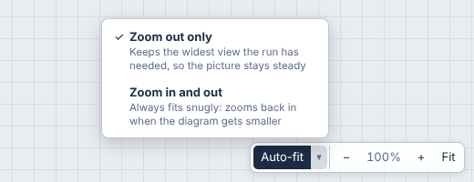

## Rearranging the memory view

Drag any box in the memory view, whether a frame or a heap object, to put it somewhere else. Arrows follow it.

A box stays where you put it as you step through the program, and through live re-runs as you edit, so you can arrange a linked list or a tree the way you think about it and then step through the algorithm. Boxes you've placed are drawn on top of the automatically placed ones, and the boxes you haven't touched keep their usual places. If a new object appears where you've put a box, it's placed below your box instead of being hidden under it. Dropping a box onto another one moves the other one out of the way.

**Reset layout** (next to the zoom controls, shown once you've moved something) puts every box back. Opening a different program or switching language also starts from a fresh layout.

How a box is recognized from one step, or one run, to the next:

- **Frames** by their position on the call stack and function name, so "the third `factorial()` call" keeps its place.
- **Objects** by their id. Ids are numbered in the order objects are first seen (`o1`, `o2`, ...), in every language, so the same program gives the same ids every run. If an edit changes the order objects are created in, a moved position can end up on a different object. **Reset layout** fixes that.

## The timeline

The bar at the bottom moves through the recorded steps. Use the buttons, drag the slider, or use the keyboard: `F10` / `Shift + F10` work everywhere, and `←` / `→` / `Home` / `End` work when the editor doesn't have focus (inside the editor those keys move the cursor). The step description next to the slider has a fixed width, so the slider never changes size as you drag it; hover the description to see all of it when it's cut off.

The timeline starts at **step 3**. Every run begins with "called Global" and "next is line 1", which both show an empty program, so they're skipped: the first step shown is the state after line 1 ran. **First step**, `Home` and replaying from the end all go there.

A step is one of:

- **Ran line N, next is line M**: the state after line N ran, just before line M runs. It matches the editor, where N is yellow and M is blue. The first step of a function just says **Next is line M**.
- **Called f()**: a new function call started, so a new frame appears.
- **f() returns X**: the function is about to return; its frame shows a `returns` row.
- **f() yields X and pauses**: a generator handed a value back; its frame shows a `yields` row and then [pauses](#generators-and-async-functions).
- **f() waits at line N and pauses**: an `async` function reached an `await`.
- **f() resumes at line N**: a paused generator or `async` function picks up where it left off.
- **Error raised on line N**: an exception is propagating.

When you edit code while sitting on the last step, the view stays on the last step of the new run, so you always see the end result of what you just typed.

### Playing a program

**Play** steps forward on its own at the speed chosen next to it (½, 1, 2, 4, 8 or 16 steps per second; your choice is remembered). `Space` plays and pauses when the editor doesn't have focus, and "AlgoViz: Play / Pause" is in the command palette for when it does. Playback stops at the last step, and pressing Play there starts again from the first step. **`Ctrl/Cmd + Enter`** plays from the step you're on, from anywhere, including the editor. Press it again while it's playing to stop and jump back to the step it started from, so you can watch the same stretch again. Any other way of moving (the buttons, the slider, the keys), editing the code, or running it pauses playback.

Moving one step at a time, whether playing or pressing `F10`, is **animated**: boxes and pointer markers slide to their new places, values that moved within a list slide from their old cell to their new one (so a swap is two values crossing), and new boxes, markers and list cells fade in (or slide in, or both, or neither: set per window in the Style panel). Arrows don't animate: each one is simply drawn in its new place, so they never flicker. Jumps (dragging the slider, `Home`/`End`) aren't animated, since there's nothing meaningful to tween across many steps. Each animation lasts 260 ms with a smooth ease-out by default (both can be changed per window in the [Style panel](#styling-the-canvas)), or less at high speeds so it always finishes before the next step. If your system asks for reduced motion, nothing animates.

## The memory view

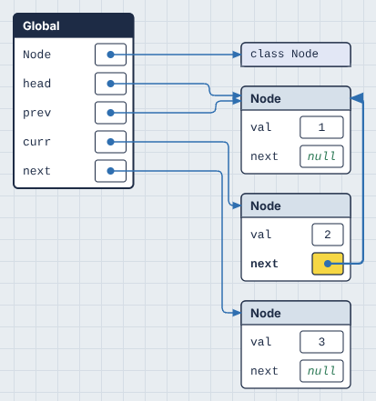

- **Frames** (scopes) are stacked on the left: `Global`, then one box per active function call. The frame that's currently executing has a dark title bar.
- **Primitives** (numbers, strings, booleans, `None`) are drawn inside the variable's cell.
- **Everything else** lives in the heap to the right and is connected by a blue arrow. Lists and tuples are rows of cells with indices above. Dicts, objects and functions are tables. Functions show the variables they've captured from an enclosing scope (closures).
- **Heap objects are arranged in columns by distance from the stack.** Things your variables point at directly sit in the first column, things those point at sit in the second, and so on. That's why a linked list or tree reads left to right.
- **Boxes never overlap.** A new box is placed below anything already in its spot, including boxes you've dragged there.
- **Yellow** means "changed since the previous step." A dashed blue outline means "this object was just created."
- **Index pointers**: small markers under a list show where variables like `i`, `j`, `lo` and `hi` point. See [pointer detection](how-it-works.md#pointer-detection) for how these are chosen.
- **Paused generators and `async` functions** are drawn under the call stack as frames with a dashed outline, titled with where they paused. See [Generators and async functions](#generators-and-async-functions).

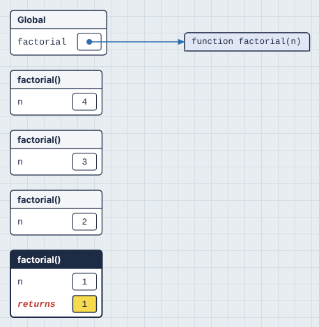

### Printed output

On the step right after a `print()` or `console.log()` runs, what it printed appears on the canvas as a dark console card under the call stack, titled with the line that printed it. Turn on **Dim others** (next to **Output** in the memory window's header) and everything else steps back too (it dims to about a quarter), so the output stands out. That's most useful exactly where the console pane is easiest to miss: a `print` on the last line, or a log from an `async` function or timer callback that runs after the script's top level is done.

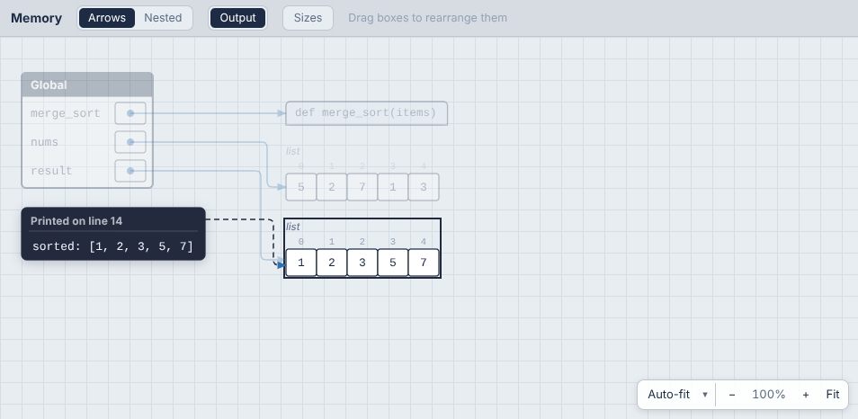

If what's printed is an object on the canvas (`print(nums)`, `console.log(node)`), it's outlined, with a dashed arrow from the card to it, and with Dim others on it stays bright too. So you can tell which of two similar lists was the one printed. A temporary that's printed and then thrown away (`print([1, 2])`) shows in the card's text only, since it isn't on the canvas.

The card is as wide as the call stack's column, which widens for a program that prints (to fit its longest printed line, up to about 45 characters, the same on every step). Longer lines wrap at spaces and commas, and output longer than a dozen lines ends with "… N more lines". The card can be dragged like any box. **Output** turns the card off, which helps when a loop prints on every pass. **Dim others** is off by default; both are remembered. Its colors are under **Colors** in the Style panel, and how it animates in (fade, slide, duration) under **Printed output**.

### Trees

A binary tree is drawn **top-down**, like in a textbook: each node sits at the height of its depth and in its in-order position, so a binary search tree reads sorted from left to right. Arrows leave a node's `left` and `right` cells, drop into the gap below it, and enter each child from the top.

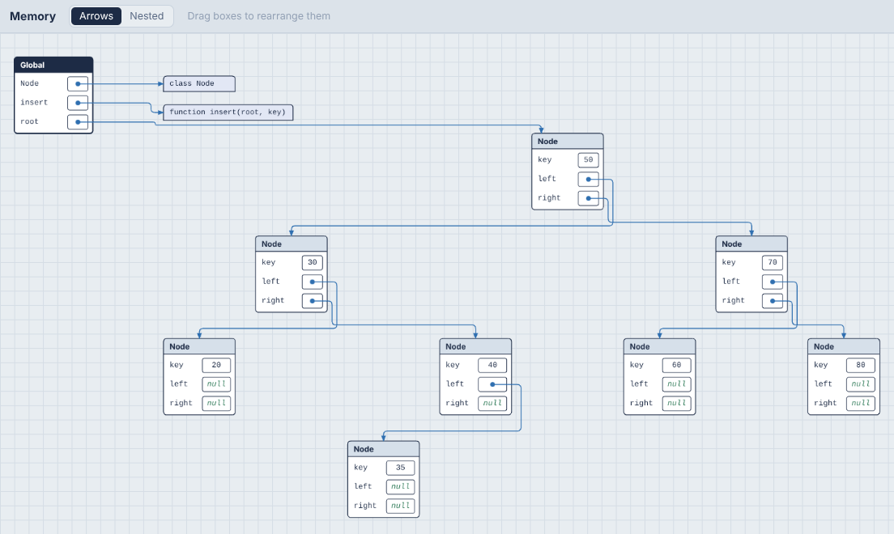

A tree is recognized the same way as in the [loop history](#linked-lists-and-trees): objects of one class with exactly two links to the same class, where no node has two incoming links. A tree with parent pointers has three links, so add a [`viz: tree` hint](hints.md#hints-viz-comments) to draw it as a tree. Trees are laid out like this in Arrows mode. Nested mode draws them as boxes in boxes. A single node isn't treated as a tree, and a node you drag leaves the tree layout and stays where you put it.

### Following the arrows

Arrows are drawn as straight runs with rounded corners, and they travel through the empty gaps between columns, so they don't cut across boxes:

- An arrow to a box on the right runs along its row, turns once in the gap, and enters the box's left side. If the box is level with it, it's a single straight line.
- An arrow to a box in the same column (a linked list being reversed, a node pointing at itself) loops out to the right and comes back into the box's right side.
- An arrow back to an earlier column goes over the top of the boxes in between, or underneath if there's no room above.
- Arrows from list cells leave downward and turn at staggered heights, like the teeth of a comb, so arrows from neighboring cells never run along each other. The leftmost cell turns highest.
- Arrows sharing a gap each get their own lane, ordered to keep crossings down, and arrows arriving at the same box get separate arrowheads.

**Hover over a box** to see what it's connected to. Its arrows, in and out, are highlighted and drawn over every box (arrows normally run behind boxes, with only their starts and arrowheads on top), the boxes at their other ends get a dashed outline, and every other arrow is dimmed. The highlight follows the box while you drag it, and stays as you step through the program with `F10`.

## Arrows or nested boxes

The **Arrows | Nested** switch in the Memory header changes how references are drawn. Your choice is remembered, and `F1` → "AlgoViz: Toggle Nested Memory View" switches it too.

- **Arrows** draws every object as its own box, with an arrow for every reference.
- **Nested** (the default) draws an object *inside* the thing that refers to it, as long as nothing else refers to it. A list in a variable sits right in the variable's row, and an object's fields hold their sub-objects. A list of lists becomes a **grid**: rows stacked, column numbers along the top, row numbers down the side. If your code indexes it as `grid[i][j]`, `i` is marked beside its row, `j` under its column, and the cell the step works on gets a dashed outline. That cell comes from the code itself: the `grid[a][b]` on the line that just ran (or, if that line doesn't touch the grid, the one about to run), with `a` and `b` worked out from the variables at that step. In a spiral traversal, `results.append(matrix[up][col])` outlines `matrix[up][col]`, even with `down`, `left`, `right` and `row` all pointing somewhere too; on lines that don't index the grid, nothing is outlined. Names like `left`, `right`, `lo` and `hi` that the code only uses for columns are drawn only under columns, and the same for rows.

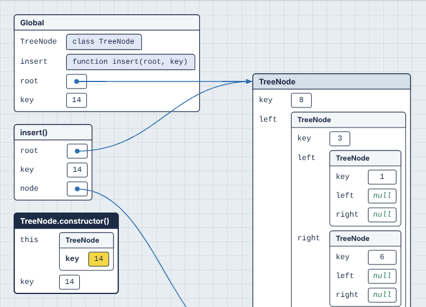

Nesting can only show "this belongs to that", so anything with more than one reference stays a separate box connected by arrows. That covers objects two variables share (aliasing), nodes that `curr` points at while they're also in a list, and cycles. In the tree above, node 10 stays separate because both `root.right` and the variable `node` point at it. That's often exactly what you want to notice: in nested mode, an arrow means "shared".

Nesting stops 6 levels deep. A deeper chain continues in a new box joined by an arrow, and nesting starts again inside it, so a long linked list becomes a few readable boxes rather than a tower.

Boxes still drag the same way in nested mode. Nested objects move with the box they're in.

## Memory sizes

**Sizes** in the memory window's header shows how much memory everything takes, the way the index row shows positions. It's for building intuition: why a list of 1,000 ints is bigger than 1,000 × 8 bytes in Python, how much room a list keeps for growth, what a hash map costs per entry compared to an array.

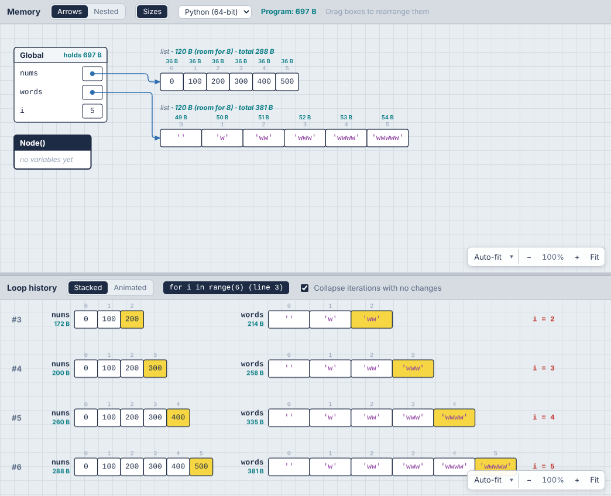

Sizes are drawn in their own color (teal by default; **Memory sizes** under Colors in the [Style panel](#styling-the-canvas)), so they never read as values:

- **The label line** of each list, dict, set or object gets the object's own size and its total: `list · 120 B (room for 8) · total 288 B`. A box with a title (dicts, objects, graphs) shows it at the right of the title bar.
- **Each cell** of a list, tuple or array gets its size, in a row above the index numbers, so you can see a Python int take 36 B (the 8-byte pointer plus the 28-byte int it points at).
- **Each frame** says how much its variables hold (`holds 697 B`).
- **The header** shows the whole program's total, everything reachable from every frame: **Program: 697 B**.
- **The loop history** shows the total of each container, linked structure or graph on every row, so you can watch it grow iteration by iteration. A Python list that's appended to jumps in steps (172 B → 200 B → 260 B …) as it reallocates.

**Own and total.** An object's own size is the object itself: its header and its slots. Its total adds everything it holds, all the way down. Anything reachable twice (two references to one node, a shared list) is counted once, so totals never double-count.

**Room for N** (Python lists only) is the list's capacity: how many items fit before it has to grow. Python over-allocates so `append` is cheap on average, and this is where you see it.

The menu next to the switch picks how sizes are counted. Each language remembers its own choice:

| Model | For | How it counts |
| --- | --- | --- |
| **Python (64-bit)** | Python (default) | What CPython really uses on a 64-bit machine, from `sys.getsizeof`. Every value is an object: an int is 28 bytes, a float 24, an ASCII string 41 + its length, and a list slot is an 8-byte pointer to the object. |
| **Textbook** | Python and JavaScript (default) | The model algorithm courses use: an 8-byte slot per element, numbers stored in the slot, one byte per character, 16 bytes (key and value) per hash map entry, 8 bytes per object field. An array of n numbers is 8n bytes. Language-neutral and easy to do in your head. Functions and classes aren't sized. |
| **Estimated (V8)** | JavaScript | An estimate of what V8 (Chrome, Node) uses on 64-bit with pointer compression: 4-byte slots, small integers stored in the slot, other numbers as 12-byte heap numbers, 12-byte object headers, `Map` and `Set` as hash tables. JavaScript can't measure objects, so these are marked `≈`. |

**Python sizes in the browser.** Pyodide is 32-bit WebAssembly, where pointers are 4 bytes, so `sys.getsizeof` there gives smaller numbers than your laptop would. The tracer converts every size to what 64-bit CPython reports, using rules measured on both (pointer-based objects double, ints gain 12 bytes, ASCII strings 20, dicts are worked out from their hash table). Lists, tuples, sets, dicts, strings and big ints come out exactly; instances and classes within a few percent.

Turning sizes on costs almost nothing: they're computed once per step and cached, and stepping is no slower in practice (about 3 ms a step either way).

## Big inputs

A trace records the program step by step, which is what lets you scrub back and forth. It keeps up to 20,000 steps, and stops after 6 seconds when you press **Run** (1.5 seconds for Live runs while you type, so the page keeps up). Rotating an array of 40,000 items right 10,000 times would be 20,000 steps or more for every rotation, so a big input would stop almost at once if every step were kept. Three things let it get further:

**Long loops are sampled.** A loop whose passes would use more than its share of the steps keeps its first 5 passes, passes at round numbers (10, 20 … 90, 100, 200 … 1,000, 2,000 …, as many as its share allows) and its last 5 passes. The passes in between still run, and are counted, but aren't recorded. The loop history shows where they were: "#6 to #9: 4 passes like these ran, not recorded". The step label says when steps were skipped just before the one you're on ("1.99K steps skipped"). A loop of unknown length (a `while`) has its passes buffered as it goes, so its last 5 are kept wherever it ends. A function called again and again from one line (a callback given to `map`, `Array.from`, `sorted(key=...)`) is sampled the same way, and so is a comprehension.

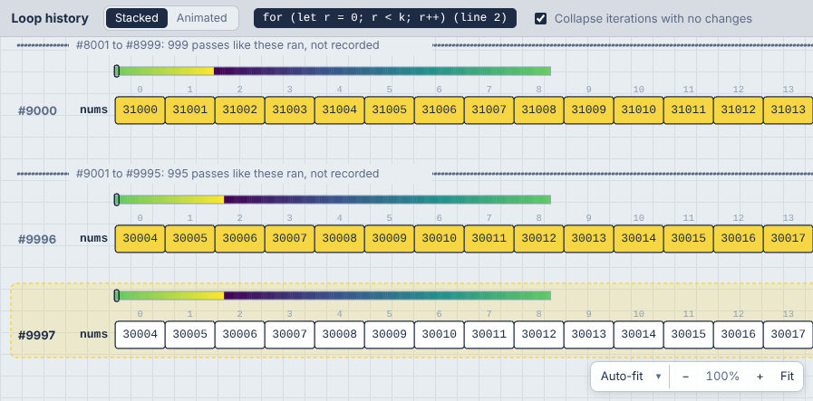

**Long lists are drawn as a strip.** A list or array of more than 60 numbers gets a band of color above its cells: 256 evenly spaced samples of the whole list, darkest for the smallest value and yellow for the largest. A bracket shows where the cells below are, and small triangles show the index variables. The 60 cells follow those index variables (`j` sweeping down a 40,000-item list shows items near `j`, with their real indices), moving 10 at a time so they don't jump on every step. In the loop history, a rotation's gradient slides along each row.

**Steps share what didn't change.** Each step stores only the objects that changed since the step before; unchanged ones are the same object in memory. That makes traces 3 to 15 times smaller, which is what makes 20,000 steps practical.

When a trace still stops early, the banner says why (the time or the step budget), how many steps ran in all, and offers **Measure**.

## Measuring at full size

Sampling shows what a big run does; it doesn't run it all. Rotating an array of 40,000 items right 10,000 times, one place at a time, is 400 million steps. **Measure** (next to **Run**, or `Ctrl + Shift + '`) runs the whole program at full size with counters instead of a trace, and shows where the time goes:

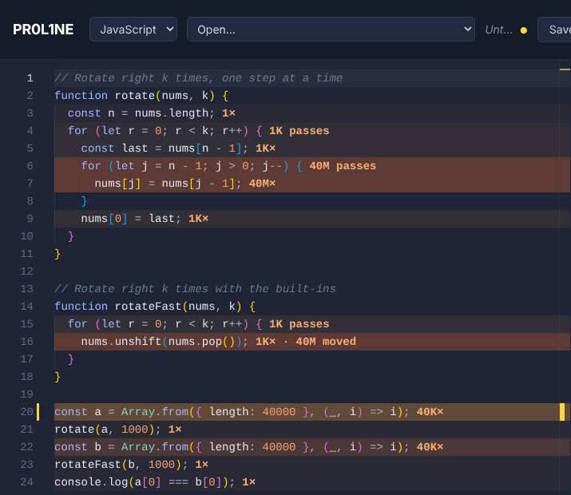

- **On every line in the editor**: how many times it ran (`40M×`), or for a loop, how many passes its body made (`1K passes`). Lines are tinted by how hot they were.
- **Work hidden inside built-ins.** `nums.unshift(nums.pop())` is one line that ran 1,000 times, but each time it moved all 40,000 items: `1K× · 40M moved`. The same goes for `list.insert(0, x)` and `list.pop(0)` in Python, `shift()` and `splice()`, `x in some_list` and `indexOf` ("scanned"), slices and `concat` ("copied"), and sorting. Same Big-O as the hand-written loop, but done in C, which is why it's so much faster: the kind of thing this is for.
- **The panel** opens with the results: the time; the totals (lines run, items processed inside built-ins, memory, and the complexity estimate from the small run beside them); the hottest lines (click one to go to it); and the output.

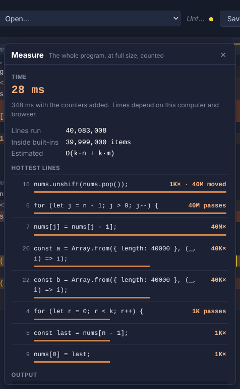

**Times.** The counters slow a program down, typically 2 to 4 times. So if the counted run was quick (under 5 seconds), the program runs once more untouched, and that's the time shown, with the counted time beside it. Times are this computer's and this browser's; Python runs as WebAssembly here, a few times slower than Python on a desktop. Counts are exact either way, so compare counts, not milliseconds, across machines.

**The time limit** (5 seconds, 20 seconds, 1 minute or 5 minutes, in the panel; 20 seconds by default) stops a run that takes too long. Progress shows in the status bar meanwhile ("Measuring… 4.1 s · 23% of line 3's loop"), and **Measure** becomes **Stop**. A run stopped at the limit still shows its counts so far, how far its outermost loop got ("31 passes of 10,000 through the loop on line 3"), and, from that, about how long the whole run would take.

**Memory** (Python): what the program's variables hold at the end, with the same 64-bit sizes as the [Sizes](#memory-sizes) view, and, for programs quick enough to run a third time with every allocation tracked, the peak. Slicing a 40,000-item list peaks higher than rotating it in place, even though both end up holding the same list. Browsers don't let a page measure a JavaScript program's memory, so JavaScript shows none.

Measure only runs when you ask (never on every edit), and editing the code takes its counts off the lines, since they'd no longer line up. Live runs wait until a measurement finishes.

## How it grows

One measurement is one number. How that number grows with the input is what separates an O(n) solution from an O(n²) one, so Measure can also run a program at several sizes.

Mark the input size with a hint naming the variable that sets it: `# viz: size n` (or `// viz: size n` in JavaScript), for a program with `n = 40000` at its top level. Name several to grow them together: `viz: size n, k`. Give a value to scale up to a bigger size than the one you trace: with `n = 200` in the code (quick to step through) and `viz: size n = 40000`, growth runs go up to 40,000. Without a hint, the **How it grows** section of the Measure panel offers to add one for the biggest number assigned at the top level.

**Measure growth** (in the panel, or "Measure Growth" in the command palette) then runs the program at n/64, n/16, n/4 and n, one after the other, each with the panel's time limit. With two or more size variables, a menu picks which grow: all together, or one alone.

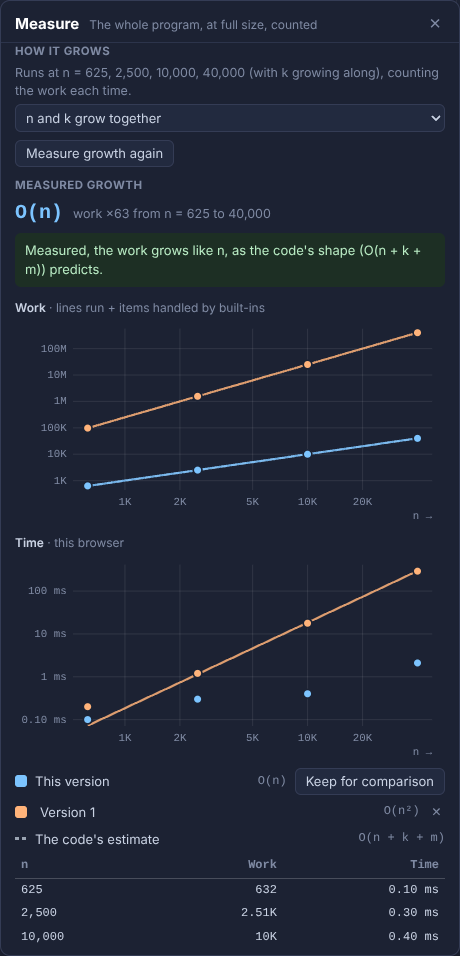

- **The measured growth**, fitted to 1, log n, n, n log n, n², n² log n or n³ from the counts (lines run plus items handled inside built-ins), on log scales, where every power of n is a straight line and steeper is worse. Counts are exact, so the fit is too; the time chart is there for the feel of it, and very quick runs can be too fast for the browser's clock to time.
- **The code's estimate**, dashed, through the largest size. When the two disagree, the panel says so and what might cause it: work below the estimate usually means a loop that stops early, a check that skips work, or a size reduced first (like `k % n`); work above it usually means a built-in that walks the data.
- **Keep for comparison** puts the results on the charts as "Version 1" (click the name to rename it). Change the code, measure its growth again, and both versions are drawn together: the naive rotation's O(n²) beside the slicing version's O(n). Up to 5 versions are kept per language, in this browser.

If a size stops at the time limit or with an error, the ladder stops there, and the panel estimates how long the full size would take from the sizes that finished.

## Time and space complexity

The **Time · Space** button in the toolbar shows how the program's running time and extra memory grow with its input, like **Time O(n²) · Space O(1)** for bubble sort, or **Time O(V + E) · Space O(V)** for breadth-first search. The editor labels each loop with how many times it runs, and each function with what it costs:

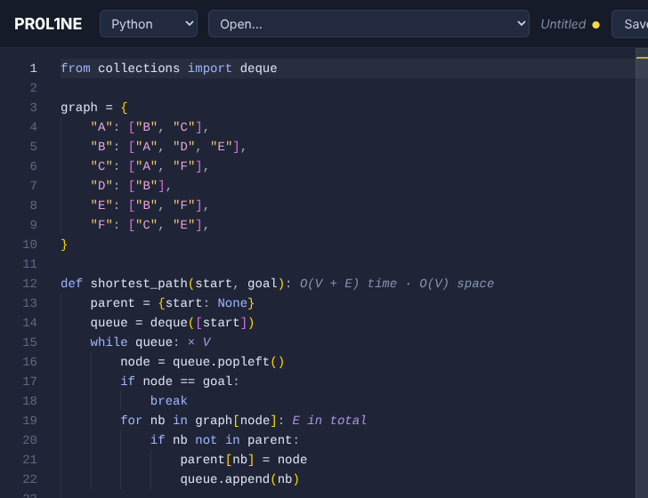

- **`× n`** after a loop: it runs n times each time it's reached. Nested loops multiply.
- **`E in total`**: an inner loop that adds up to a total over the whole outer loop instead of multiplying it, like a BFS visiting each edge once, or a sliding window whose left edge only moves forward.
- **`O(n log n) time · O(n) space`** after a function definition.

Hover a label for the reasoning. Click the button for the whole explanation:

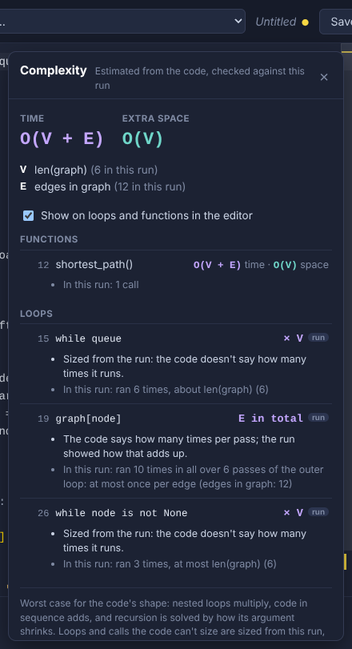

- **The sizes.** What n, m, V and E stand for in this program (`n = len(nums)`, `V = len(graph)`, `E = edges in graph`), with their values in this run. Sizes come from your own variable names: a loop over `range(len(nums))` is n, nested loops over a grid's rows and columns are n·m, a dict of neighbor lists gives V and E, and a linked structure of objects is counted in nodes.
- **Each function**: its time and space, and how they were worked out (*calls itself twice on half of n, with n work per call: n log n in all*; *remembers its answers (a memo), so it does the work once per value of n*), with the run's own counts (*25 calls in all, 6 deep at most*).
- **Each loop**: its label, whether it was sized from the code or from the run, and what the run did (*ran up to 5 times per run, expected about 5*). Click any row to jump to that line.
- **Worth knowing**: costly operations hiding inside loops, like `queue.shift()` in JavaScript (it moves every item, so a BFS that uses it is O(V²) rather than O(V + E)), `x in some_list` in Python, or copying a slice.

**How it's worked out.** First from the code's shape: nested loops multiply, code in sequence adds, `range(n)` is n, a loop that halves its range (`mid = (lo + hi) // 2`) is log n, and built-ins have their known costs (`sorted` is n log n, `in` on a list is n, on a set is 1). Recursion is solved by its pattern: one call on `n - 1` is n deep; two calls on halves with linear work is n log n; two calls on `n - 1` is 2ⁿ, unless the function keeps a memo.

**Then it's checked against the run**, which fixes what reading the code alone gets wrong:

- A loop the code doesn't bound (`while queue:`) is sized by how many times it ran, matched to the program's inputs: *ran 6 times, about len(graph) (6)*. These loops get a small **run** badge in the panel.
- An inner loop that ran about as many times in total as its outer loop is **amortized**: it adds rather than multiplies. That's how a sliding window comes out O(n) and a BFS O(V + E), not O(n²) and O(V·E).
- Recursion the code can't classify, like a flood fill or a DFS guarded by a visited set, is sized by how many calls the run made. Exponential recursion that made far fewer calls than 2ⁿ is pruned by something (a check, a cache), and is counted that way.
- Collections your code builds (a queue, a `seen` set, a result list) are sized by how big they got, in terms of the inputs.

**Space** is the extra memory beyond the input: collections the code creates and fills, copies (slices, `sorted()`, `[...arr]`), and the call stack's depth for recursion. The inputs themselves aren't counted.

It's the **worst case for the code's shape**, not the average case. An early `break` or a lucky input doesn't make a loop count for less. Turn the editor labels off with the checkbox in the panel (it's remembered).

## Loop history

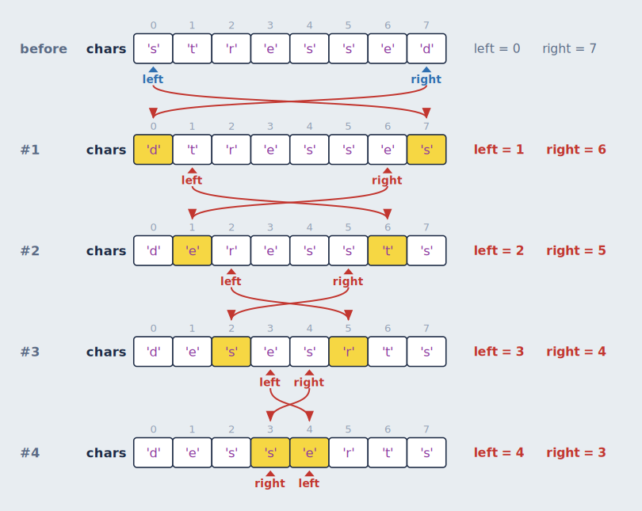

When the current step is inside a loop, the bottom section stacks the state at the end of every iteration so far, starting with a **before** row for the state when the loop was entered. Between rows:

- **Yellow cells** changed during that iteration.
- **Red arrows** connect each changed cell to its previous row. When a value moved from one index to another (a swap), the arrow starts at the index it came from, so swaps show as crossing arrows.
- **Variables to the right** (`i = 2`, `left = 3`) are the scalars that change during the loop. The ones that changed in that iteration are red.
- **The current iteration** is highlighted while the loop is still running.

**Each run's header, with its values.** Above a loop's rows, its header is shown as written and as it ran: `for j in range(n - 1 - i)  →  for j in range(0, 3)`, or in JavaScript `for (let j = 0; j < n - 1 - i; j++)  →  for (j = 0; j < 3; j++)`. That's for loops that count (a Python `range`, or a JavaScript `for` with a start, a bound and a step), so you can see which range this run covers without working it out. Loops over a list, and `while` loops, show only their rows.

### All loops together

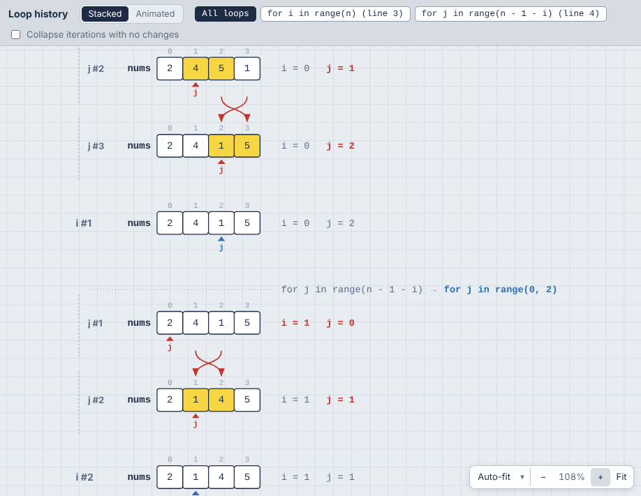

When loops are nested in the same function, **All loops** (the first tab, and the default) draws them in one history, in the order things happened: every pass of the inner loop, indented under a header with that run's range (`for j in range(0, 3)`, then `range(0, 2)`...), then the row for the outer pass it was part of, its state once the inner loop is done. Labels name the loop's variable (`j #2`, `i #1`), and arrows and highlights compare each row with the row above it, across loops. Collapsed rows and [sampled](#big-inputs) passes are per loop: `j #4 to #9: nothing changed`.

The other tabs show one loop at a time, as before: pick one to see only its passes. Loops in different functions (a loop inside a function called from a loop) are always separate tabs. Animated mode shows one loop, since it draws a single live row.

### One above another

When a loop works on several things at once (a list and a linked list, two arrays, a grid and a queue, a graph and the list it fills), they're drawn side by side in each row. Tick **One above another** in the Loop history header to draw each on its own line instead, left-aligned with their names in one column, and the iteration (`#4`) and its variables (`i = 2  j = 0`) at the middle of the stack. Separate linked lists get a line each too: in "add two numbers", `l1`'s nodes, `l2`'s and the result list are three lines instead of one long one. Nodes that are linked at any point during the loop count as one list, so a new node is on its list's line from the moment it's created, before it's linked in; lists that get merged share a line. Rows get taller but narrower, so wide structures don't push each other off screen, and in Animated mode each one stays put while it changes. Changes are shown by the yellow highlights; the red arrows between rows are left out in this layout, since they'd have to cross the other lines. The choice is remembered.

### Stacked or animated

The **Stacked | Animated** switch in the Loop history header picks between two views of the same loop. Your choice is remembered.

- **Stacked** is the history described above: one row per iteration, so you can compare any iteration with any other.
- **Animated** (the default) shows a single row: the loop's state at the current step. As you step or [play](#playing-a-program), cells change in place and values slide between cells, so a sort visibly shuffles its values into order and a linked list's arrows turn around one by one. Cells that changed on that step are yellow. The row keeps the same layout (columns, cell widths, tree shape) as the stacked view, so nothing jumps around between steps.

  With nested loops (and **All loops** picked, the default), each loop gets its own live row: when an inner loop starts, its row appears under the loop around it, indented under its header, instead of replacing it. Both change as you step, each compared with its own state a step before. Only the innermost loop that's running has the running highlight: the loops around it are waiting on it. An inner loop that isn't running (between its runs, or once it's done) stays as it last was, and the highlight goes back to the loop around it. Pick one loop's tab to see just that one.

Stacked is better for seeing the whole story at once, and Animated for following what a single step does.

### Grids

A list of lists (a matrix, a game board, a dynamic programming table) is drawn as a grid in every row, with the same i/j markers as nested mode: `i` beside its row, `j` under its column, and an outline on the cell where they meet. Cells that changed in an iteration are yellow, so a dynamic programming table visibly fills in, one cell per iteration:

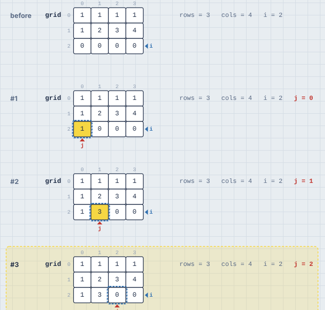

A grid doesn't show markers for one past its last column, since a name like `cols` would otherwise always sit there.

### Linked lists and trees

Linked nodes don't have indices, so the loop history gives them some. If the loop's variables lead to objects that link to objects of the same class (a `next`, or `left` and `right`), every node gets a fixed column, the same in every row, and each row shows where the links point at that moment:

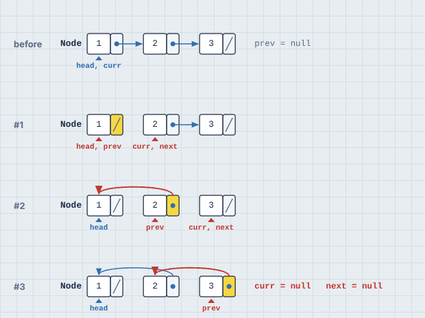

- Each node is its **value** (the first plain field, like `val` or `key`) followed by a **slot per link**. A slash in a slot means `null`/`None`.
- A link to the next column is a short straight arrow. Other links arc over the row. A second link field, like `right` in a tree, arcs underneath.
- A link that changed in that iteration is **red** and its slot is highlighted. A changed value is yellow, like a changed list cell.
- **Variables pointing at nodes** (`head`, `prev`, `curr`) are markers under the node, like `i` and `j` under a list. Inside a method, nodes reached through an object are found too, labeled `self.head` or `this.head`.
- Columns follow the links from the start of the loop, so the starting list reads left to right.

**Binary trees are drawn top-down.** If the class has exactly two links and no node ever has two incoming links, it's a tree. Each node keeps its in-order column (so a binary search tree reads sorted from left to right), and sits at a height set by its depth. Links go from the bottom of each slot down to the child:

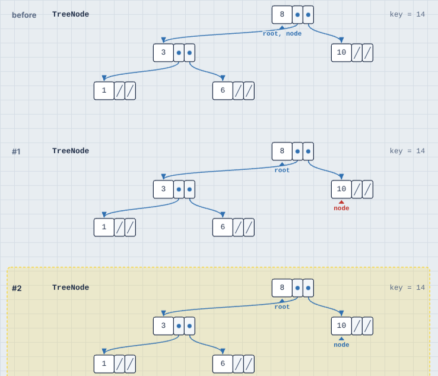

A doubly linked list also has two links (`prev` and `next`), but its nodes have two incoming links each, so it's drawn as a list.

Nodes the code can no longer reach (say, the old head after it's dropped) leave the row. Plain JavaScript objects like `{ val: 1, next: null }` count as nodes too.

**Collapse iterations with no changes** folds runs of iterations that didn't modify any container or linked node into a single "#4 to #6: nothing changed" line. This only applies to loops that modify data somewhere. In a loop that only reads (like binary search), the moving indices are the interesting part, so every row is kept:

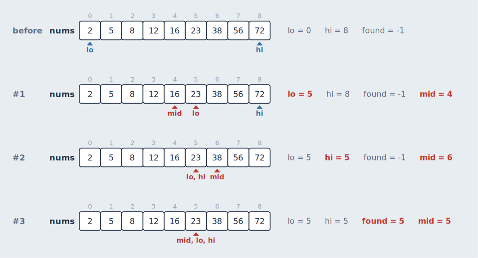

## Graphs

When your data is a graph, the memory view draws it as one: nodes and edges in a single box, laid out once for the whole run so nodes never move while you step. What's recognized:

| In your code | Recognized |
| --- | --- |
| A dict, object or `Map` of neighbor lists or sets: `{"A": ["B", "C"], ...}` | Automatically, when most neighbors are also keys (so `{"fruit": ["apple"]}` isn't mistaken for one) |
| Weighted: `{"A": {"B": 4}}`, or `{"A": [("B", 4)]}` | Automatically. Weights label the edges |
| Objects that hold lists, sets or dicts of each other: `city.roads`, `node.children` | Automatically. This covers graphs of objects, trees with any number of children, and tries (a dict's keys label its edges) |
| Neighbors by number: `adj = [[1, 2], [0], [0]]` | With a hint, `viz: graph adj`, because a grid looks the same |
| An adjacency matrix: `m = [[0, 1], [1, 0]]` | With a hint, `viz: graph m`. A square list of lists is read as a matrix |
| An edge list: `edges = [(0, 1), (1, 2, 5)]` | With a hint, `viz: graph edges`. JavaScript arrays need `viz: graph edges edgelist` |

A graph is **undirected** when every edge goes both ways, and **directed** (with arrowheads) otherwise. It's drawn in **layers** when it reads well that way, so a dependency graph or a trie reads from top to bottom:

- **Where the search starts is on top.** The first node your algorithm queues or visits is the top of the picture.
- **Cycles are fine.** In a directed graph with a few cycles, the edges that close a cycle (back to a node above) point up, curving around the nodes in between.
- **Long edges bend around nodes** instead of running through them, and the layers are ordered to cross as few edges as possible.
- **A tree's children stay in your order**, left to right.
- **Separate pieces** sit side by side, and nodes with no edges in a block to the right.

A single loop of nodes (a ring) is drawn as a circle, starting at the top, and so is a small graph where most nodes link to each other, when that crosses fewer edges.

Other graphs (undirected graphs with cycles, bigger dense graphs) are laid out so that nodes a few edges apart sit about that far apart on screen. A grid comes out as a grid, edges are kept clear of nodes they don't connect (bending around one when they must), and where the search starts is at the top left. Separate pieces are packed in rows. Self-loops are drawn as a small loop off the node's side, and an edge listed twice as two edges side by side. Edge weights sit halfway along their edge, or nearby when that spot would cover a node or another weight. The same graph is always laid out the same way.

A layered graph with a very wide layer (eight nodes or more, a picture more than two and a half times wider than tall) is drawn **left to right** when its window is taller than it is wide (side by side, say): the layer becomes a column, which fits a tall window far better. In a wide window it stays top to bottom. A `sideways` [graph hint](hints.md#graph-options) draws a layered graph left to right always.

Edges are straight, curving only around a node or through the layers a long edge crosses. A [graph hint](hints.md#graph-options) can ask for `curved` edges (gentle arcs), `straight` ones, or `angled` ones (horizontal and vertical lines with rounded corners, like a circuit diagram): `// viz: graph roads angled`.

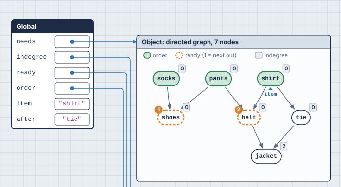

### Your algorithm's state, drawn on the graph

The variables your algorithm uses are drawn on the graph, the way you'd mark it up on a whiteboard. Nothing has to be declared. What a variable means is read from its type, and where the type isn't enough, from its name:

| A variable that holds... | Is drawn as |
| --- | --- |
| A set of nodes (`visited`, `seen`), a dict of node → `True`, or one `True`/`False` per node | Filled-in green nodes |
| A list named like a result (`order`, `result`, `done`, `topo`...) | Filled in, like a visited set |
| Any other list, or a `deque`, of nodes | Dashed orange rings, numbered in the order they'll come out. That's the front of a queue, the top of a stack (named `stack` or `todo`), or the smallest of a heap (named `heap`, `pq` or `frontier`, or holding `(priority, node)` pairs) |
| A dict of node → number or text (`dist`, `indegree`, `color`), or one number per node | A small label beside each node |
| A dict of node → node named like a parent (`parent`, `prev`, `came_from`), or one parent per node | Green arrows: the search tree. Links that aren't edges of the graph, like a union-find forest, are dashed |
| A list of nodes named like a path (`path`, `route`, `trip`) | Purple arrows along the path |
| A list of `(a, b, ...)` edges named like `mst`, `tree` or `chosen` | Those edges in purple |
| One node (`node`, `u`, `v`, `cur`, `start`, `goal`, `nb`, `next`...), or any variable pointing at a node object | A ▲ marker with its name, under the node |

A legend at the top of the graph names the variables. Whatever changed in the last step gets a yellow halo, like a changed cell, and markers slide from node to node when [animated](#playing-a-program). A name that doesn't fit the conventions can be added with a hint: `viz: graph graph: here, there`.

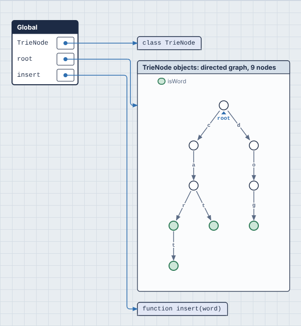

**In the loop history**, every row draws the graph with that iteration's state, so you can watch a BFS frontier spread out row by row. In animated mode, one graph changes as you step. The algorithm's other variables (`dist`, `heap`, `visited`) are still shown as rows of cells next to it. The graph's own dict isn't, since the picture already shows it.

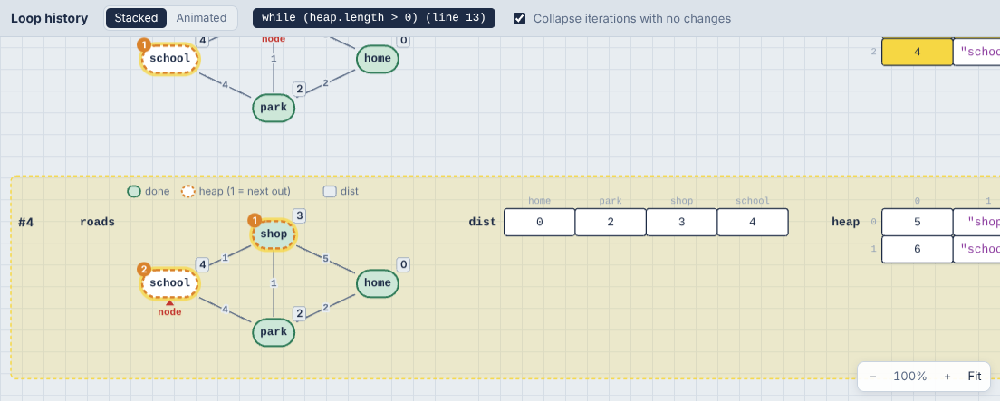

Graphs look the same in Nested mode, since a graph can't be drawn as boxes inside boxes. To see the dict behind a graph instead, add `viz: plain graph`.

## Generators and async functions

A generator or `async` function can stop partway through and carry on later, so it doesn't fit the usual call stack, where a call is pushed, runs to the end and is popped. PR0L1NE gives each one its **own frame that's suspended and resumed** instead:

1. Calling `next()` (or `for ... of`) on a generator, or calling an `async` function, pushes its frame like any call.
2. At a `yield`, the step reads **fibonacci() yields 2 and pauses**, and the frame shows the value in a `yields` row. At an `await`, the step reads **f() waits at line N and pauses**.
3. The frame then leaves the call stack and is drawn below it, dashed, titled **fibonacci(), paused at line 4**. Its variables are still there, and still connected by arrows, because they're still alive.
4. When the generator is asked for its next value, or the awaited promise settles, the same frame moves back onto the stack (**f() resumes at line N**), at the same position and with the same variables, and carries on.

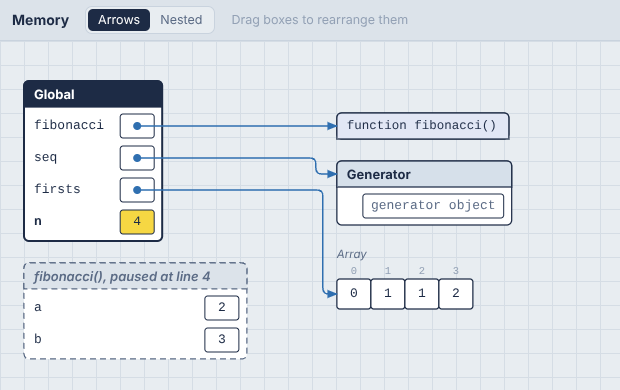

A paused frame stays on the canvas until its generator finishes or is thrown away. A loop inside a generator keeps its iteration count while it's paused, so the loop history keeps working across `yield`s.

**JavaScript's event loop** runs too. After your script ends, pending `await`s continue, and `setTimeout` and `setInterval` callbacks run, in the order their timers would fire. Timers run on a **virtual clock**: a `setTimeout(f, 5000)` runs immediately rather than after five seconds, but always after timers due sooner, so the program behaves as it would for real without making you wait. The **Program finished** step comes after the last callback. A promise rejection that nothing handles stops the run with an error, as it would in Node. `for await` loops work, and so do `async` generators.

**Python** follows the same rules for generators, generator expressions and `asyncio` coroutines (`asyncio.run`, `await`, `asyncio.gather`, `asyncio.sleep`). A generator object in the heap says where it's paused, like `fibonacci() paused at line 4`. `asyncio` gets a **virtual clock** too: `asyncio.sleep(2)` costs no real time, but tasks still wake in the order their sleeps end. That works the same in the browser and on your machine (see [how](how-it-works.md#asyncio-on-a-virtual-clock)).

The examples include "Generator (Fibonacci)" in all three languages, "Async tasks (asyncio)" for Python, and "Async tasks and timers" for JavaScript and TypeScript.
